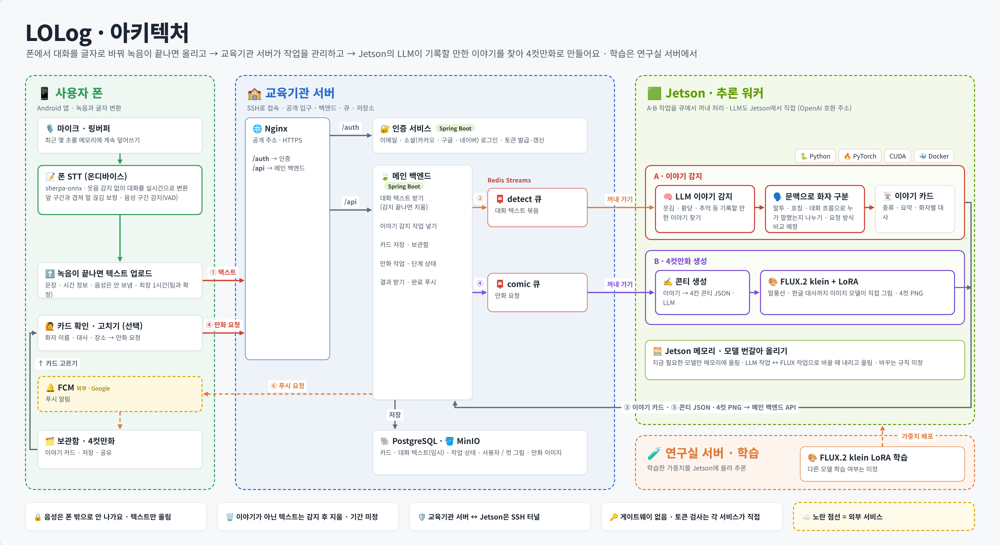

# LOLog

**흘려보낸 웃긴 대화를 4컷만화로 남기는 서비스**

친구와 나눈 웃긴 이야기, 황당한 순간, 추억이 될 대화는 금방 잊힙니다.
LOLog는 대화를 기록해 두었다가 기록할 만한 이야기를 찾아 카드로 모으고, 고른 카드를 4컷만화로 그려 줍니다.

## 프로젝트 개요

- **배경**
  - 친구, 가족과 나눈 웃긴 대화나 황당한 순간은 사진처럼 남지 않아 금방 잊힙니다.
  - 다시 보려면 직접 녹음하고 처음부터 다시 들어야 해서 남기기 어렵습니다.
- **목표**
  - 일상 대화에서 기록할 만한 이야기를 AI가 자동으로 찾아 카드로 보관하기
  - 고른 이야기를 4컷만화로 만들어 다시 보고 싶은 콘텐츠로 남기기
- **팀 규모**: 3명
- **기간**: 2026년 11월 2일 ~ 2026년 11월 27일

## 동작 방식

1. 🎙️ 앱이 대화를 녹음하면서 폰에서 바로 글자로 바꿉니다.
2. 🧠 서버의 AI가 웃기거나 황당하거나 추억이 될 만한 이야기를 찾아, 누가 무슨 말을 했는지 나눠 카드로 정리합니다.
3. 🗂️ 카드는 나만 보는 보관함에 쌓입니다. 원하면 화자 이름, 대사, 장소를 고칠 수 있습니다.
4. 🎨 카드를 골라 요청하면 말풍선까지 들어간 4컷만화를 그려 주고, 완성되면 알림을 보냅니다.

## 아키텍처

| 구역 | 하는 일 | 기술 |
| --- | --- | --- |
| 📱 앱 | 녹음, 폰 안에서 실시간 음성 인식, 보관함·만화 보기 | Android, sherpa-onnx |
| 🏫 서비스 서버 | 로그인, 메인 백엔드, 작업 큐, 저장소 | Nginx, Spring Boot, Redis Streams, PostgreSQL, MinIO |
| 🟩 추론 서버 | 이야기 찾기와 화자 구분, 4컷만화 그리기 | NVIDIA Jetson, 로컬 LLM, FLUX.2 klein + LoRA |
| 🧪 학습 서버 | 그림 모델 LoRA 학습 | PyTorch |

- 대화 텍스트를 외부 AI 서비스로 보내지 않고, 우리 Jetson에서 직접 돌리는 LLM으로 처리합니다.
- 완료 알림은 FCM 푸시로 보냅니다.

## 팀

| 이름 | 역할 |
| --- | --- |
| 민주 | AI · 보안 · 인프라 |
| 서현 | 앱 · AI 모델링 |
| 지원 | 백엔드 · 앱 |
