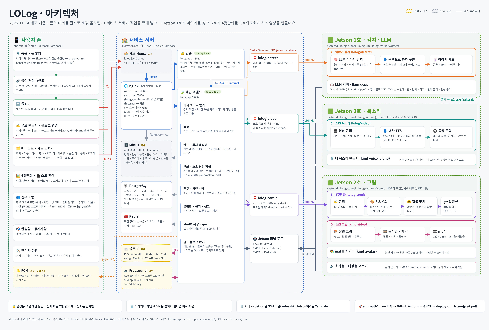
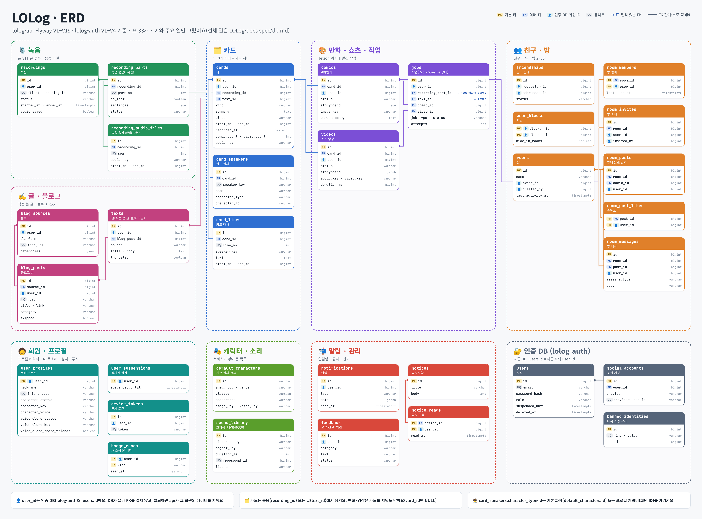

# LOLog

**흘려보낸 웃긴 대화를 콘텐츠로 남기는 서비스**

친구와 나눈 웃긴 이야기, 황당한 순간, 추억이 될 대화는 금방 잊힙니다.
LOLog는 대화를 기록해 두었다가 기록할 만한 이야기를 찾아 카드로 모으고, 고른 카드를 4컷만화와 쇼츠 영상으로 만들어 줍니다.

🌐 **서비스 페이지: [lolog.java21.net](https://lolog.java21.net)** · 기능 소개와 Android 앱(APK) 내려받기

## 프로젝트 개요

- **배경**
  - 친구, 가족과 나눈 웃긴 대화나 황당한 순간은 사진처럼 남지 않아 금방 잊힙니다.
  - 다시 보려면 직접 녹음하고 처음부터 다시 들어야 해서 남기기 어렵습니다.
- **목표**
  - 일상 대화에서 기록할 만한 이야기를 AI가 자동으로 찾아 카드로 보관하기
  - 고른 이야기를 4컷만화와 쇼츠 영상으로 만들어 다시 보고 싶은 콘텐츠로 남기기
  - 친구와 같이 쓰는 방에서 만화를 나누며 함께 웃기
- **팀 규모**: 3명
- **기간**: 2026년 11월 2일 ~ 2026년 11월 27일

## 팀

| 이름 | 역할 |
| --- | --- |
| 민주 | AI · 인프라 |
| 서현 | 앱 · 화면 디자인 |
| 지원 | 백엔드 · 앱 |

## 동작 방식

1. 🎙️ 앱이 대화를 녹음하면서 폰에서 바로 글자로 바꿉니다. 소리는 폰 밖으로 나가지 않습니다.
2. ✍️ 녹음 말고 직접 쓴 글이나 연결한 블로그 글로도 카드를 만들 수 있습니다.
3. 🧠 서버의 AI가 웃기거나 황당하거나 추억이 될 만한 이야기를 찾아, 누가 무슨 말을 했는지 나눠 카드로 정리합니다.
4. 🗂️ 카드는 나만 보는 에피소드에 쌓입니다. 원하면 화자 이름, 대사, 장소를 고치고 화자를 더하거나 뺄 수 있습니다.
5. 🔊 "음성도 저장"을 켜고 녹음하면 카드에서 그 순간의 실제 목소리를 다시 들을 수 있습니다. 전체 녹음 파일은 7일 뒤 지웁니다.
6. 🧑‍🎨 화자마다 기본 캐릭터나 친구가 사진으로 만든 프로필 캐릭터를 붙이면, 모든 컷을 같은 얼굴로 그립니다.
7. 🎨 카드를 골라 요청하면 말풍선까지 들어간 세로 4컷만화를 그려 주고, 완성되면 알림을 보냅니다.
8. 🎬 쇼츠 영상을 요청하면 화자마다 다른 목소리(내 목소리도 가능)로 대사를 읽고, 장면 그림·입모양(립싱크)·자막과 효과음·배경음을 붙인 세로 영상을 만듭니다.
9. 📤 완성된 만화는 갤러리에 저장하거나 카카오톡·인스타그램으로 공유하고, 친구와 같이 쓰는 방에 올려 좋아요와 댓글을 주고받을 수 있습니다.

## 주요 기능

| 기능 | 내용 |
| --- | --- |
| 🎙️ 녹음 · 폰 STT | 백그라운드 녹음(최장 3시간), 말한 구간만 골라 폰 안에서 글자로 바꿈, 1시간마다·끝날 때 텍스트 업로드 |
| 🔊 음성 저장 · 순간 다시 듣기 | 켰을 때만 AAC로 올림, 모바일 데이터면 지금 올릴지 Wi-Fi에서 올릴지 물어봄, 카드 구간만 잘라 남김 |
| ✍️ 글 · 블로그 | 직접 쓴 글(일기·일화)로 카드 만들기, 블로그 연결(네이버 블로그·티스토리·velog·Medium·WordPress는 플랫폼별로, 나머지는 RSS로 읽기), 카테고리 골라 새 글을 카드로 |
| 🗂️ 에피소드 · 카드 고치기 | 이야기 카드 모아 보기, 화자·대사·장소 고치기, 화자 더하기·빼기 |
| 🧑‍🎨 화자 캐릭터 · 목소리 | 기본 캐릭터 24명, 사진 1장으로 만드는 프로필 캐릭터, 캐릭터 목소리 미리 듣기·고르기, 문장 하나(5~10초)를 읽어 만드는 내 목소리 |
| 🖼️ 4컷만화 | 카드마다 3번까지, 콘티 → 컷 그림 → 얼굴 찾기 → 말풍선 합성, 완성 푸시 |
| 🎬 쇼츠 영상 | 영상 콘티 → 대사 TTS(내 목소리 포함) → 장면 그림 → 움직임·전환·립싱크·자막 → 효과음·배경음(Freesound CC0) 섞기 → 세로 mp4, 폰에 저장 |
| 👥 친구 · 방 | 친구 코드로 요청·수락, 차단, 방 만들기·초대, 만화 올리기, 좋아요·댓글, 안 읽은 수 |
| 📬 알림함 · 공지사항 | 받은 알림 모아 보기, 종 아이콘의 새 소식 점, 오류 신고·의견 보내기 |
| 🛠️ 관리자 | 관리자 계정으로 공지 쓰기, 신고 확인, 사용자 정지·탈퇴 |
| 🔐 계정 | 이메일 가입(인증번호 메일), 구글·네이버 로그인, 비밀번호 찾기·바꾸기, 탈퇴 |

## 아키텍처

지난 버전(`lolog-architecture_v*.png`)도 이 폴더에 함께 있습니다.

| 구역 | 하는 일 | 기술 |
| --- | --- | --- |
| 📱 앱 | 녹음, 폰 안에서 실시간 음성 인식, 음성 저장(선택), 에피소드·만화·쇼츠·친구·방·알림함·관리자 화면 | Android(Kotlin, Jetpack Compose), sherpa-onnx + SenseVoice-Small, Silero VAD |
| 🏫 서비스 서버 | 로그인, 메인 백엔드, 작업 큐, 저장소 | Nginx, Spring Boot, Redis Streams, PostgreSQL, MinIO, Docker Compose |
| 🟩 Jetson 1호 | 이야기 찾기, 화자 구분, 만화·영상 콘티를 짜는 LLM | NVIDIA Jetson, llama.cpp + Qwen3.5-4B |
| 🟩 Jetson 2호 | 4컷만화 그리기, 쇼츠 장면 그림·립싱크·효과음과 배경음 섞기·영상 합치기, 사진으로 프로필 캐릭터 만들기 | NVIDIA Jetson, FLUX.2 klein(학습 없이 원본), MediaPipe, ffmpeg |
| 🟩 Jetson 3호 | 쇼츠 대사를 화자 목소리나 내 목소리로 읽기 | NVIDIA Jetson, Qwen3-TTS |

### 작업 흐름

메인 백엔드는 무거운 AI 작업을 직접 하지 않고 Redis Streams 큐에 넣어 두고, 각 Jetson의 워커가 SSH 터널로 꺼내 가서 처리한 뒤 결과를 `/internal` API로 돌려줍니다.

| 큐 | 꺼내 가는 곳 | 작업 |
| --- | --- | --- |
| `lolog:detect` | Jetson 1호 | 대화 텍스트 묶음(직접 쓴 글은 `kind: text`)에서 이야기 찾기 → 화자 구분 → 이야기 카드 |
| `lolog:comic` | Jetson 2호 | 4컷만화, 쇼츠 그림 단계(`kind: video`), 프로필 캐릭터(`kind: avatar`) |
| `lolog:video` | Jetson 3호 | 쇼츠 목소리 단계: 영상 콘티 → 대사 TTS → 음성 트랙, 내 목소리 등록(`kind: voice_clone`) |

쇼츠 영상은 두 대를 차례로 거칩니다. 3호가 목소리를 만들어 메인 백엔드에 올리면, 메인 백엔드가 그림 단계를 2호 큐에 넣습니다. Jetson끼리는 Tailscale로 이어져 있어 2호와 3호도 1호의 LLM으로 콘티를 짭니다.

### 개인정보와 보안

- 대화 텍스트를 외부 AI 서비스로 보내지 않고, 우리 Jetson에서 직접 돌리는 LLM과 TTS로 처리합니다.
- 이야기가 아닌 텍스트는 감지가 끝나면 바로 지웁니다.
- 음성은 사용자가 켰을 때만 올리고, 전체 녹음 파일은 7일 뒤 지웁니다. 방에는 만화 그림만 보입니다.
- 프로필 캐릭터를 만든 사진은 그림을 만든 뒤 지웁니다.
- 내 목소리 녹음 원본은 내 목소리를 만드는 데만 쓰고 다른 사람에게 공개하지 않으며, 내 목소리를 지우거나 탈퇴하면 같이 지웁니다.
- 게이트웨이 없이 각 서비스가 JWT를 직접 검사하고, 정지·탈퇴한 사용자는 Redis 표시로 바로 막습니다.
- 완료 알림은 FCM 푸시로 보냅니다.

### 배포

- 서비스 서버: 학교 Nginx(HTTPS) 뒤에 우리 nginx 컨테이너를 두고 `/auth`, `/api`, 그림 주소로 나눕니다. `/internal`은 밖에서 막습니다.
- api · auth: main에 머지하면 GitHub Actions가 테스트하고 GHCR 이미지를 만든 뒤 서버의 `deploy.sh`로 바꿔 띄웁니다. 실패하면 이전 이미지로 되돌립니다.
- Jetson: systemd로 터널, LLM 서버, 워커를 띄우고 코드는 `git pull`로 받습니다.

## ERD

이 그림은 간략화한 ERD입니다. lolog-api Flyway V1\~V19와 lolog-auth V1\~V4의 표 33개를 모두 그렸지만, 표마다 키(PK·FK·유니크)와 주요 열만 넣었고 일부 열은 한 줄로 합쳤습니다(예: `age_group · gender`). 모든 열과 제약은 [LOLog-docs spec/db.md](https://github.com/LOLog-2026/LOLog-docs/blob/main/spec/db.md)에 있습니다.

## 레포

| 레포 | 내용 |
| --- | --- |
| [LOLog-docs](https://github.com/LOLog-2026/LOLog-docs) | 기능 요구사항, 기능 명세, API 명세, 기능별 명세(음성·다시 듣기·화자 그림·내 목소리·친구·방·알림함·관리자·쇼츠·효과음·글·블로그) |
| [LOLog-api](https://github.com/LOLog-2026/LOLog-api) | 메인 백엔드 (Spring Boot · 대화 텍스트 받기 · 카드 · 만화·쇼츠 작업 · 작업 큐 · 음성 · 화자 캐릭터·목소리·내 목소리 · 글·블로그 RSS · 효과음 모음 · 친구 · 방 · 알림함 · 공지 · 신고 · 푸시) |
| [LOLog-auth](https://github.com/LOLog-2026/LOLog-auth) | 인증 (Spring Boot · 이메일 가입 · 구글·네이버 로그인 · 토큰 발급·갱신 · 비밀번호 찾기 · 탈퇴 · 관리자 정지·탈퇴) |
| [LOLog-app](https://github.com/LOLog-2026/LOLog-app) | Android 앱 |
| [LOLog-ai](https://github.com/LOLog-2026/LOLog-ai) | AI 워커(이야기 감지 · 4컷만화 · 쇼츠·립싱크 · 프로필 캐릭터 · 내 목소리) · 실험 |
| [LOLog-infra](https://github.com/LOLog-2026/LOLog-infra) | 서버 배포 설정 (Docker Compose · Nginx · Jetson 터널·systemd) · 소개 페이지([lolog.java21.net](https://lolog.java21.net)) |

